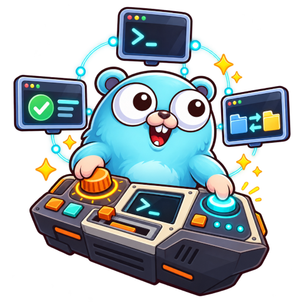
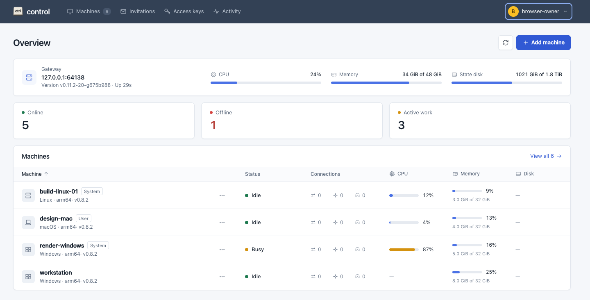

# Control

<p align="center">
  
</p>

<p align="center">
  <a href="https://github.com/koltyakov/control/releases/latest"></a>
  <a href="https://github.com/koltyakov/control/actions/workflows/ci.yml"></a>
  <a href="LICENSE"></a>
</p>

Tell your AI agent what you need and which machine should do it.

Control joins your Windows, Linux, and macOS machines into a private fleet and gives each one a name. After that you work in plain language. Mention a machine in a request to Claude Code, Codex, OpenCode, Cursor, or another MCP client, and the agent does the work there:

> Build the release on `win-build` and tell me if any tests fail.

> Encode yesterday's recording on `gpu-box` and put the result on `nas`.

> Something is filling the disk on `linux-worker`. Find out what.

You don't need to learn Control's commands. The agent finds your machines, sees what each one can do, starts the work, follows it, and brings back the result. Long work runs as a task on `win-build`, not in your chat session. Close the laptop and it keeps going. Come back later and ask how it went.

<p align="center">
  <picture>
    <source media="(prefers-color-scheme: dark)" srcset="./assets/console-overview-dark.png" />
    
  </picture>
</p>

<p align="center"><em>The web console overview, showing the sample fleet from the browser test fixture.</em></p>

Control is self-hosted, MIT licensed, and one CGO-free Go binary.

## You describe the work, the agent runs it

One command connects your AI client, and a second adds the skill that teaches it Control's CLI:

```sh
control install-mcp claude
control install-skill claude
```

Supported names are `opencode`, `codex`, `claude`, `cursor`, `copilot`, `windsurf`, `antigravity`, and `agents`. See [connect an AI client](#4-connect-an-ai-client).

To approve a local CLI command or agent session, see [Control Vault](docs/vault.md). To restrict an access key to selected workers, use the [fleet access lock in the web console](docs/console.md#lock-worker-access).

From then on the agent has what it needs to turn a sentence into work on a named machine:

- Machine names, with each machine's OS, resources, and current load.
- A description of what each machine can run, with the input schema for every capability.
- Tools to run commands, follow logs, move files, open tunnels, and plan steps across machines.
- Your saved [runbooks](docs/runbooks.md), which tell it how you want repeatable work done on a given machine.

You pick the machine and the outcome. The agent picks the commands. It can use whatever is installed on that machine and permitted by its profile, and [the limits below](#what-an-agent-can-and-cannot-do) apply to it.

AI agents are optional. Everything an agent does goes through the same client as the CLI, so you can run the same work by hand or from a script:

```sh
control exec gpu-box -- nvidia-smi
control exec win-build --detach --id build-42 --timeout 4h -- msbuild app.sln
control task logs win-build build-42 --follow
```

## What you can ask for

Each example below gives a request you might make, then the CLI that does the same work. An agent chooses its own steps, so treat the commands as the equivalent, not a transcript.

### Run long jobs that outlive your session

> Start the release build on `worker`. It takes a few hours, so check on it when I ask.

```sh
control exec worker --detach --id job-001 --timeout 4h -- COMMAND ARG...
control task logs worker job-001 --follow
control task wait worker job-001
control task cancel worker job-001
```

Every task has an ID. Submitting the same ID and specification again is acknowledged as the existing task, not run twice. A worker restart does not rerun an interrupted task. After a lost response you query the same ID; Control never retries a side effect on its own. Use a new ID for new work.

For a structured request whose result you need immediately, submit and wait in one invocation:

```sh
control task start worker --wait '{"id":"list-001","capability":"files.list","args":{}}'
```

Workers keep finished records, logs, and workspaces for seven days and up to 10,000 tasks by default. `control task list NODE --limit 100` pages through them, and `control task reconcile NODE ID` inspects an interrupted workflow's child tasks without replaying them. See [task recovery and limits](docs/protocol.md#bounded-task-results-and-recovery).

A busy worker still accepts independent work. By default it runs four commands and eight built-in file or HTTP operations at once, and queues the rest. See [worker concurrency](docs/protocol.md#worker-concurrency).

### Open a remote terminal without SSH

Set `"shellEnabled": true` in the target node's config and restart that node. From a local terminal with an account login:

```sh
control shell linux-box -- bash
control shell windows-box -- cmd
control shell windows-box -- powershell
control shell windows-box -- pwsh
```

Use a shell installed on the worker. A User shell starts in the remote user's home directory. A System shell starts in the worker's `workDir`. The session runs as the worker's OS account, supports keyboard input and resizing, and ends on exit or disconnect. There is no SSH server or additional listening port. See [interactive shells](docs/protocol.md#interactive-shells) for permissions and limits.

### Chain steps across machines

> Generate a test clip on `source`, encode it on `worker`, and tell me when both steps are done.

A workflow is one task that plans steps on several machines. Steps run in sequence by default, or up to 16 at once with `maxParallel`. This is [examples/workflow-task.json](examples/workflow-task.json), which the Compose suite runs across separate containers. A machine named `source` generates a video, and a machine named `worker` fetches it directly from `source` and encodes it:

```json
{
  "id": "media-workflow-001",
  "capability": "workflow.run",
  "args": {
    "steps": [
      {
        "name": "generate",
        "target": "source",
        "task": {
          "capability": "exec.run",
          "args": {
            "command": "ffmpeg",
            "args": ["-y", "-f", "lavfi", "-i", "testsrc=size=320x240:rate=10", "-t", "1", "-c:v", "mpeg4", "source.mp4"]
          },
          "outputs": ["source.mp4"]
        }
      },
      {
        "name": "encode",
        "target": "worker",
        "needs": ["generate"],
        "inputs": [{ "step": "generate", "artifact": 0, "path": "input.mp4" }],
        "task": {
          "capability": "exec.run",
          "args": {
            "command": "ffmpeg",
            "args": ["-y", "-i", "input.mp4", "-vf", "scale=160:-2", "-c:v", "mpeg4", "output.mp4"]
          },
          "outputs": ["output.mp4"]
        }
      }
    ]
  }
}
```

```sh
control task start source --wait @examples/workflow-task.json
```

A step can also pick its machine when you submit. `{"select": {...}}` chooses one eligible machine, and `{"each": {"labels": {"env": "prod"}}}` runs the step on every match. A step marked `"when": "always"` is planned cleanup that still runs after a failure. [examples/workflow-fanout-task.json](examples/workflow-fanout-task.json) rotates logs on every `env=prod` machine and then removes a lock file on each one. See [target selection and fan-out](docs/protocol.md#target-selection-and-fan-out) and [cleanup steps](docs/protocol.md#cleanup-steps).

### Move large files

> Copy `./input.mp4` to `worker`, and bring back `output.mp4` when the encode finishes.

```sh
control upload start worker ./input.mp4 incoming/input.mp4 --id input-001
control upload status worker input-001
control artifact export worker output.mp4
control artifact get worker ARTIFACT_ID ./output.mp4
```

[Uploads](docs/uploads.md) use one stream, keep durable checkpoints, and resume only when you ask. They never overwrite an existing file. Artifacts are identified by SHA-256, and downloads resume and verify the hash. Inside a workflow, a step's output travels from the worker that produced it to the worker that needs it, without passing through your laptop.

### Reach private networks and local dev servers

> I need the database that only `worker` can reach. Put it on my local port 15432.

```sh
control tunnel worker db.internal:5432 --listen 127.0.0.1:15432
control tunnel worker 127.0.0.1:3000 --reverse --listen 127.0.0.1:3000
control tunnel worker --socks --listen 127.0.0.1:1080
control tunnel worker --https-proxy --listen 127.0.0.1:8443
```

The first command reaches a database that only `worker` can see. The second serves your local dev server on `worker`'s loopback, so a browser there can open `http://localhost:3000`. The last two create application-configured SOCKS5 and HTTPS/HTTP2 CONNECT proxies through the worker. `control tunnel start` keeps a fixed-destination tunnel after the invoking command exits. See [tunnels](docs/tunnels.md) and [fleet streaming](docs/streaming.md).

A worker can also make an HTTP request from its own network with `http.request`, and `control clipboard paste worker` sends your [clipboard](docs/clipboard.md) to it.

### Drive desktop apps and browsers

> Open the admin page in the browser on `worker`. I'll sign in, then you export the monthly report.

Both are opt-in per worker and use upstream tools you install there. [`desktop.run`](docs/desktop.md) operates agent-desktop, and [`browser.run`](docs/browser.md) operates agent-browser.

```sh
control call worker desktop.run '{"command":"snapshot","app":"Example login"}'
control call worker desktop.run '{"command":"setValue","ref":"@SNAPSHOT:e2","secret":"app.password"}'
control browser view worker --port 4848
```

`setValue` fills a field from a secret stored on the worker, so the password never appears in the request. `control browser view` forwards the worker's browser dashboard to a loopback URL on your machine. When a site needs a login or a one-time code, you pause the agent, [sign in yourself](docs/browser.md#human-takeover-and-2fa), and hand back.

### Use credentials without putting them in a prompt

> Check which AWS identity `worker` is using. The keys are stored there as `aws.access-key-id` and `aws.secret-access-key`.

Store a credential on the worker yourself, at a hidden prompt:

```sh
control secrets set aws.secret-access-key
```

Then refer to it by name:

```sh
control call worker exec.run '{"command":"aws","args":["sts","get-caller-identity"],"envSecrets":{"AWS_ACCESS_KEY_ID":"aws.access-key-id","AWS_SECRET_ACCESS_KEY":"aws.secret-access-key"}}'
```

The request and the stored task hold names only. The worker resolves each name when the command starts and masks the values in the returned text and logs. Control has no command, RPC method, or MCP tool that reads a secret's value back. A [use policy](docs/secrets.md#restrict-where-a-secret-can-be-used) can restrict a secret to named consumers and HTTP destinations. [Worker-local secrets](docs/secrets.md) describes what this does and does not protect.

### Watch and manage the fleet

> Which machines are online, and which has the most free memory? Wake `workstation` if it's asleep.

```sh
control machines
control dashboard
control system worker --refresh
control speedtest worker --size 64 --json
control diagnostics worker
control wake workstation
```

`control dashboard` is a [terminal dashboard](docs/dashboard.md), and the gateway URL serves the [web console](docs/console.md). [Wake-on-LAN](docs/wake.md) starts an offline machine through a peer on the same LAN. [Runbooks](docs/runbooks.md) hold shared or machine-specific instructions for repeatable work; `control runbooks` lists them and never executes them. [Leases](docs/protocol.md#shared-pool-leases) reserve a machine for workflows that need exclusive execution.

A worker can run AI software of its own too. Its profile can name installed [AI CLIs and MCP servers](docs/protocol.md#ai-cli-and-mcp-configuration), which run as the node's OS user.

## What an agent can and cannot do

Handing a fleet to an AI agent is a real risk, so here is what Control enforces.

- **Fleets are private.** The gateway scopes discovery, signalling, relay, and enrollment to the account that owns the machines.
- **Only a logged-in client starts work.** Your CLI or MCP session, authenticated with your account key, can run work on your machines. An enrolled machine can discover its peers but cannot run commands on them by its own authority. A script or AI CLI running on a worker does not inherit yours.
- **Worker-to-worker work needs a grant for that exact instruction.** When one worker must act on another, your client asks the destination for a grant that names the requesting worker, the method, and the arguments. Grants expire after one hour idle. You can list and revoke them, and revoking cancels the tasks and streams admitted under them. See [authority and delegation](docs/delegation.md).
- **Each worker can narrow its callers.** `allow` rules in the node profile restrict which methods a caller may use, including your own account client.
- **Credentials stay on the worker.** Secrets are referenced by name, resolved at execution, and masked in returned text.
- **Nothing is replayed.** Control does not automatically retry a task, an upload, or an action with an uncertain outcome.
- **Peers verify each other.** Machines keep persistent Ed25519 identities and use mutually authenticated TLS on both direct and relayed connections.
- **Releases are signed.** Public releases carry pinned Ed25519 manifest signatures, and a missing or unknown key fails closed.

What it does not do:

- **There is no execution sandbox.** A command runs with the OS permissions of the node that executes it. An agent using your login can run whatever your workers allow, so choose `allow` rules and each node's [startup context](docs/installation.md#choose-a-startup-context) with that in mind.
- **Secrets guard against accidental exposure, not extraction.** The store is not encrypted, and an unrestricted command on the same worker can read it. Masking covers text results. It does not cover screenshots, files, or live browser frames.
- **You trust the gateway** for naming, membership, and executable distribution.

See [security boundaries](docs/principles.md#authority-is-explicit-at-the-destination) and [what secrets protect](docs/secrets.md#what-this-protects).

## How it differs from SSH over a mesh VPN

SSH over a mesh VPN gives you reachability and a shell. Control works one level up:

- Work is a task with an ID, a state, retained logs, and a result, on Windows as much as on Linux and macOS. Nothing assumes a Unix shell on the remote machine.
- Files are hashed artifacts that workers hand to each other.
- An AI client gets structured tools and per-machine capability descriptions, not a raw terminal.
- Machines cannot command each other without a grant from the destination.

## Architecture


Orchestrators coordinate work. Worker nodes execute it and exchange files directly. These are operation roles, not machine types, and the same node can do either. The gateway handles enrollment, discovery, connections, and fleet administration. It does not execute work.

Peers connect directly over WebRTC and fall back to a WebSocket relay through the gateway. A local HTTP API handles node-local operations. See [architecture](docs/architecture.md) and [terminology](docs/terminology.md).

## Get started

You need one gateway that every machine can reach over HTTPS. There is no hosted gateway. The supported path is a small Linux VPS with a domain.

To watch a gateway and three nodes work together before deploying anything, the Compose test pool runs them in Docker. See [keep a deployment for debugging](docs/testing.md#keep-a-deployment-for-debugging). It is a test fixture, not an installation path.

### 1. Run a gateway

Follow the [Linux VPS guide](docs/gateway.md) for Ubuntu/Debian setup with systemd, Caddy HTTPS, and user accounts. Already running expose? Use the [expose gateway guide](docs/expose.md) instead of Caddy.

Point a domain at the VPS, allow TCP 80/443, and keep the gateway on `127.0.0.1:7330` behind the proxy. Create accounts with `control users create NAME`. Give users their own account keys, never the gateway superuser key.

The gateway URL also serves the [web console](docs/console.md). Set a separate browser password with `control console password`; operators sign in as `@operator`. Operators can provision an existing user's browser login with `control console password NAME`. CLI account keys are not browser passwords.

### 2. Install the CLI and log in

Linux or macOS:

```sh
curl -fsSL https://raw.githubusercontent.com/koltyakov/control/main/scripts/install.sh | sh
```

Windows, from PowerShell, CMD, or Bash:

```powershell
powershell.exe -NoProfile -c "irm https://raw.githubusercontent.com/koltyakov/control/main/scripts/install.ps1|iex"
```

The installers download the latest GitHub release. On Windows, open a new terminal to reload PATH.

Log in with the account key supplied by your gateway operator:

```sh
control login --gateway https://control.example.com
control machines
```

Login saves the validated URL and key. Remote work needs no local node:

```sh
control exec worker -- hostname
control call worker node.describe
```

`control machines --compact` returns short records, and `--node NAME` filters to one machine. See [discovery options](docs/protocol.md#gateway-observation).

To also run this machine as a worker:

```sh
control setup --name main --client opencode
```

Setup reuses your login and installs node startup, MCP, and the skill. On Windows, it requires Administrator PowerShell by default; `--service user` selects startup at login under your normal account.

### 3. Add machines

```sh
control machines add win-worker --platform windows --service user
control machines add mac-worker --platform macos --service user
control machines add linux-worker --platform linux --service system
control machines add workstation --platform linux --service hybrid
```

Each command prints a one-time install command. Run it on its target under the intended user. Windows uses PowerShell and requests UAC for firewall setup. macOS uses Bash; Linux system mode needs sudo and systemd. Installers detect amd64/arm64, verify the binary, and enroll and start the node without an account key. Verify with `control machines` and `control call win-worker node.describe`.

Use `auto` or omit the name for the target's hostname. Installation URLs use an 8-character, single-use ticket and expire after 15 minutes by default. Nodes generate separate full-length security credentials. Press `a` in the dashboard to add a machine. Use `--force` when adding or renaming to retract a conflicting pending invitation, never an enrolled identity. See [platform requirements](docs/installation.md#install-workers-on-each-platform).

User context has the installing user's files and credentials but may stop at logout. System context starts at boot as root on Linux/macOS or LocalService on Windows. See [startup contexts](docs/installation.md#choose-a-startup-context).

Hybrid installs isolated User and System profiles. Address `workstation` for User work or explicitly choose `workstation-system` for System work. The System companion runs as root or Windows LocalSystem and requires exact instruction grants. It is never selected automatically or used as a fallback. See [Hybrid installation](docs/installation.md#hybrid-user-and-system-contexts).

### 4. Connect an AI client

Install either or both on the orchestrator. MCP exposes tools; the skill teaches CLI usage. Both install globally by default.

```sh
control install-mcp opencode
control install-skill opencode
```

Replace `opencode` with `codex`, `claude`, `cursor`, `copilot`, `windsurf`, `antigravity`, or `agents` for other clients. Add `--project .` for project-local installation. Restart the AI client afterward. The release installer already installs the OpenCode skill.

The `agents` target uses `~/.agents/mcp.json` and `~/.agents/skills/control/SKILL.md`, or project-local equivalents. Manual MCP import may be needed. See [configuration paths](docs/installation.md#mcp-and-skills).

For other MCP clients, configure a stdio server running `/absolute/path/to/control mcp`. It uses your saved login, without a local node. Explicit `--api` or `CONTROL_API` selects local-node authority, not independent peer execution.

## Updates

`control update` updates the CLI from GitHub Releases. The gateway stages verified binaries and updates nodes only while they are idle; busy nodes stay pending and offline nodes catch up on startup. With saved superuser authorization, `make update` pushes a development bundle to the gateway and nodes, and `make update-status` tracks it.

See [managed updates](docs/updates.md) for rollout order and restart behavior, [release keys, rotation, and recovery](docs/updates.md#release-signing-keys), [signed release verification](docs/updates.md#publish-github-releases), and [migrating an older startup entry](docs/updates.md#migrate-an-existing-supervisor).

## Build and test

Requires Go 1.27.4 or newer. No CGO dependency.

```sh
make build
make fmt-check
make lint
make check
make test-compose
```

Run `make install` to install the local build and refresh your installed Control skill bundles. This installs the OpenCode skill by default and refreshes existing managed global copies for other supported clients.

Compose tests run a gateway, three nodes, and an FFmpeg workflow over WebRTC and relay. Docker supplies dependencies. See `make help` and [testing](docs/testing.md) for other targets and benchmarks.

## Documentation

- [Linux VPS gateway](docs/gateway.md), [gateway behind expose](docs/expose.md), [installation and enrollment](docs/installation.md), [users and private fleets](docs/users.md), [authority and delegation](docs/delegation.md).
- [Configuration and protocol](docs/protocol.md), [web console](docs/console.md), [dashboard and metrics](docs/dashboard.md), [managed updates](docs/updates.md).
- [TCP tunnels](docs/tunnels.md), [connection tests](docs/connections.md), [fleet streaming](docs/streaming.md), [installing through a worker proxy](docs/gateway-proxy.md), [Wake-on-LAN](docs/wake.md).
- [Streaming file uploads](docs/uploads.md), including local CLI/MCP sources and interrupted-transfer recovery.
- [Native agent-desktop and GUI workflows](docs/desktop.md), [worker-local secrets](docs/secrets.md), [clipboard pastes](docs/clipboard.md), [runbooks](docs/runbooks.md).
- [agent-browser and remote browser viewing](docs/browser.md), including manual login/2FA and browser-session cleanup.
- [Terminology](docs/terminology.md), [architecture](docs/architecture.md), [engineering principles](docs/principles.md), [design decisions](docs/decisions.md).
- [Testing](docs/testing.md), [examples](examples), [contributor guide](AGENTS.md).
- Upgrading from the removed RPA adapter? See [RPA migration differences](docs/desktop.md#migrate-from-rpa).

## Status and limits

Control is pre-1.0. Commands, configuration, and protocol details can still change between releases.

One gateway, no clustering, public signup, billing, or execution sandbox. Providers have their node's OS permissions. Keep account keys and gateway state inaccessible to workers, and the local API on loopback. Trust the gateway for naming, membership, and executable distribution. See [security boundaries](docs/principles.md#authority-is-explicit-at-the-destination).

## Licence

[MIT](LICENSE)
